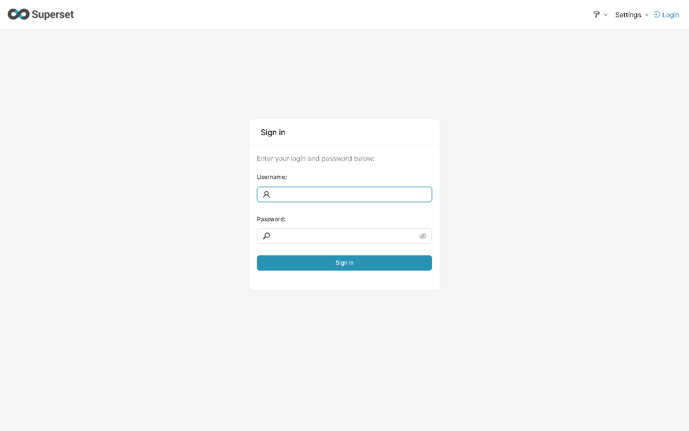
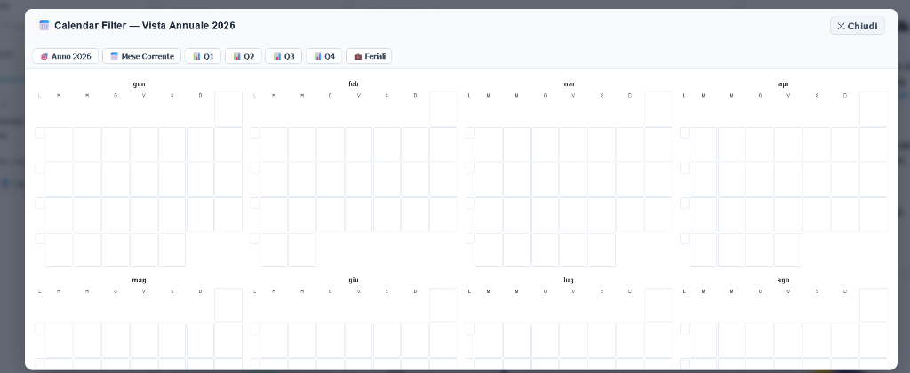
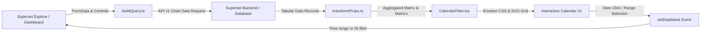

# StratumCalendar (Calendar Filter) - Interactive Heatmap & Native Filter Plugin for Apache Superset

[](https://superset.apache.org/)
[](LICENSE)
[](https://www.typescriptlang.org/)
[](https://reactjs.org/)
[](#)

**StratumCalendar** (Calendar Filter) is an interactive calendar heatmap visualization plugin for **Apache Superset 6.1.0+** engineered for temporal exploratory data analysis. It functions simultaneously as an interactive dashboard visualization, an exploratory cross-filter, and a native dashboard filter component - allowing users to slice and filter companion dashboard charts simply by clicking individual dates or date ranges.

---

## 📸 Visual Preview

### 📊 Dashboard Cross-Filtering in Action



*Figure 1: Calendar Filter integrated into an Apache Superset dashboard, driving cross-filtering across companion analytical charts.*

### 🗓️ Month View & Selection Detail



*Figure 2: Interactive month view with multi-date selection, metric intensity heatmap ramp, ISO 8601 week numbers, and rapid month/year navigation.*

---

## 🌟 Key Features

### 1. 📅 Dual Navigation Modes (Month View & Year Overview)
- **Month View**: Focused single-month calendar with quick navigation (`<` / `>`), year selector dropdown, and one-click return to "Today".
- **Year Overview**: Comprehensive 4x3 grid displaying all 12 mini-calendars simultaneously, providing an executive bird's-eye view of annual trends and distributions.

### 2. 🖱️ Intuitive Interactive Selection
- **Click**: select a day. With one day already selected, clicking another selects the range between them; clicking the selected day clears it.
- **Drag**: press on a day and drag to another to select the range; releasing outside the calendar ends the drag.
- **Week and month**: click a week number to select that week, or a month name in the year overview to select that month.
- **Shortcuts**: whole year, current month, quarters Q1-Q4, working days of the month, plus relative periods (today, yesterday, this/last week, last 7/30/90 days, month to date, last month, last quarter, year to date, last year). Choose which relative shortcuts appear.
- **Keyboard**: Tab reaches the grid, arrow keys move by a day or a week, Enter or Space select.
- **Clear All**: instant reset to restore the baseline dashboard state.

### 3. 🔄 Dual Role: Visual Chart & Native Dashboard Filter
- **Standard Chart Mode**: Renders as an informative heatmap chart on any dashboard, emitting `setDataMask` cross-filters when dates are clicked.
- **Native Filter Mode**: Can be embedded into Superset's **Filter Bar** as a native filter component.
- **Works on any column**: the filter targets the *Filter target column* option, then the heatmap column, then the column a native filter is bound to. Date, timestamp, text-date or integer-epoch columns all work (see [Cross-Filter API Payload](#-cross-filter-api-payload)). If no column can be determined the calendar says so and sends no filter, instead of filtering on a guessed name.

### 4. 🎨 Metric-Driven Heatmap & Color Schemes
- **6 Color Palettes**: *Superset Default*, *Greens*, *Blues*, *Oranges*, *Reds*, and *Purples*. Days with data are colored; days without data stay white, and a real value of zero is shown with the lightest shade so the two are distinguishable.
- **Color scale**: linear, logarithmic, square root, or your own thresholds, so a few very high days do not flatten the rest.
- **Several rows per day**: combine them with sum, average, maximum, minimum or row count. Without a metric each row counts as one record.
- **Legend**: color ramp with the lowest and highest value and the "no data" swatch.
- **Calendar Standards**: ISO 8601 week numbers and configurable start of week (Sunday or Monday).
- **Rich Tooltips**: date, holiday name, value, maximum and percentage of the maximum.

### 5. 🎉 Holidays & Language
- **Holidays**: highlight the Italian national holidays (Easter and Easter Monday are computed), your own list (`2026-06-15` for one day, `12-24=Christmas Eve` for every year), or both. The working days shortcut can skip them.
- **Language**: month names, weekdays and buttons in Italian, English, or the browser language.

---

## 🏛️ Architecture Overview



---

## 📁 Repository Structure

```
superset-plugin-chart-calendar-filter/
├── package.json                    # Plugin manifest & dependencies
├── tsconfig.json                   # TypeScript build settings
├── jest.config.js                  # Jest test configuration
├── installer/
│   ├── install.js                  # Cross-platform Node.js installer
│   ├── install.bat                 # Double-click Windows batch launcher
│   └── INSTALLER.md                # Comprehensive installer documentation
├── docs/
│   ├── INSTALL.md                  # Manual installation instructions
│   └── screenshots/                # High-resolution screenshots & assets
├── src/
│   ├── index.ts                    # Plugin entry point & export
│   ├── CalendarFilter.tsx          # Main React visualization component
│   ├── types.ts                    # TypeScript interfaces & models
│   ├── hooks/
│   │   ├── useCalendarData.ts      # Metric aggregation & date mapping
│   │   ├── useSelectionMask.ts     # Selection state & filter dispatch
│   │   ├── useMacroActions.ts      # One-click selections (year/quarter/weekdays/week/month/relative periods)
│   │   ├── useCalendarTooltip.ts   # Tooltip state & viewport positioning
│   │   └── useViewSelection.ts     # Dropdown view changes that propagate the mask
│   ├── plugin/
│   │   ├── index.ts                # ChartPlugin & ChartMetadata registration
│   │   ├── buildQuery.ts           # Query constructor (groupby & metrics)
│   │   ├── controlPanel.ts         # Explore UI controls & native filter options
│   │   └── transformProps.ts       # Data transformation pipeline
│   ├── styles/
│   │   └── CalendarFilter.styles.ts # Emotion styled components
│   ├── utils/
│   │   ├── dateUtils.ts            # Date formatting & range calculations
│   │   ├── filterMask.ts           # Builds the filter sent to Superset (range / list / formats)
│   │   ├── presets.ts              # Relative periods (last 30 days, last quarter, ...)
│   │   ├── holidays.ts             # Italian holidays (with Easter) and custom lists
│   │   ├── colorScale.ts           # Linear / log / sqrt / threshold scales and heat colors
│   │   ├── labels.ts               # Italian / English texts and shared display context
│   │   ├── gridKeys.ts             # Keyboard navigation for the day grids
│   │   └── themeUtils.ts           # Color palettes & base color for heat scale
│   └── images/
│       └── thumbnail.png           # 100x100 chart picker thumbnail
├── test/                           # Comprehensive Jest test suite (164 tests)
└── demo/                           # Standalone browser demo bundle
```

---

## 🚀 Quick Installation in Apache Superset

The repository includes a cross-platform installer that auto-discovers your Superset directory, builds the plugin, links dependencies, and patches `MainPreset`:

### Option 1: Double-Click Batch Launcher (Windows)
Double-click:
👉 **`installer/install.bat`**

### Option 2: Cross-Platform Node.js CLI
```bash
# Auto-detect Superset location:
node installer/install.js

# Or specify your Superset root directory:
node installer/install.js "D:\Sviluppo\superset"
```

The installer autonomously:
1. Locates `superset-frontend/`.
2. Compiles the TypeScript plugin (`npm run build`).
3. Adds `superset-plugin-chart-calendar-filter` into `superset-frontend/package.json`.
4. Idempotently registers `CalendarFilterPlugin` in `MainPreset.ts` with the key `calendar_filter`.
5. Prompts for optional Docker overrides and native filter configurations.

### Option 3: Manual Installation
1. Copy the plugin folder into `superset-frontend/plugins/superset-plugin-chart-calendar-filter`.
2. In `superset-frontend/src/visualizations/presets/MainPreset.ts`:
   ```typescript
   import { CalendarFilterPlugin } from 'superset-plugin-chart-calendar-filter';

   new CalendarFilterPlugin().configure({ key: 'calendar_filter' }),
   ```
3. Clear stale Webpack cache:
   ```bash
   rm -rf superset-frontend/node_modules/.cache
   ```

---

## 🐳 Docker Compose Deployment

```bash
cd /path/to/superset
docker compose -f docker-compose-non-dev.yml up -d --build superset
```

Launch `http://localhost:8088`, create a new chart, and select **Calendar Filter**!

---

## 🎛️ Explore Control Panel Reference

| Control | Section | Default | Description |
|:---|:---|:---|:---|
| `metric` | Query | Empty | Optional metric that colors the days. Without one, each row counts as one record. |
| `groupby` | Query | Empty | Optional date column that colors the days. Leave empty to use the calendar only as a filter. |
| `date_column` | Query | Empty | **Filter target column.** Any dataset column. Defaults to the heatmap column, or in a native filter to the column it is bound to. |
| `value_aggregation` | Query | `sum` | How several rows of the same day become one value: sum, average, maximum, minimum, row count. |
| `color_scheme` | Appearance | `supersetColors` | Palette: `supersetColors`, `greens`, `blues`, `oranges`, `reds`, `purples`. |
| `scale_type` | Appearance | `linear` | `linear`, `log`, `sqrt` or `steps` (your own thresholds). |
| `scale_thresholds` | Appearance | Empty | Comma separated thresholds for `steps`, e.g. `10, 50, 100`. |
| `show_legend` | Appearance | `true` | Color ramp with lowest value, highest value and the "no data" swatch. |
| `first_day_of_week` | Appearance | `0` | `0` Sunday, `1` Monday. |
| `locale` | Appearance | `it` | `it`, `en` or `auto` (browser language). |
| `show_week_numbers` | Layout | `false` | ISO 8601 week numbers; clicking one selects that week. |
| `show_year_dropdown` | Layout | `true` | Year selector for quick navigation. |
| `enable_overview` | Layout | `true` | 4x3 year overview; clicking a month name selects that month. |
| `cell_density` | Layout | `compact` | `compact` or `normal`. |
| `holiday_mode` | Holidays | `none` | `none`, `it` (Italian national holidays plus your list) or `custom` (your list only). |
| `custom_holidays` | Holidays | Empty | One per line or comma separated: `2026-06-15` (one day), `12-24` (every year), optional `=Name`. |
| `exclude_holidays_from_workdays` | Holidays | `true` | The working days shortcut skips highlighted holidays. |
| `filter_type_mode` | Filter behaviour | `auto` | `auto` (range if contiguous, otherwise list), `time_range` or `in_clause`. Charts saved before this option keep `time_range`. |
| `in_value_format` | Filter behaviour | `date` | Format of listed days to match the column type: `date`, `datetime` or `epoch_ms`. |
| `default_value_mode` | Filter behaviour | `none` | Selection applied on open: today, current month/year, any relative period, or a custom range. |
| `custom_default_start_date` / `custom_default_end_date` | Filter behaviour | Empty | `YYYY-MM-DD`, used when the initial selection is a custom range. |
| `show_macro_shortcuts` | Filter behaviour | `true` | Shows the shortcut buttons. |
| `enabled_presets` | Filter behaviour | last 7 / 30 days, last month, year to date | Relative-period buttons to show, in order. |

---

## 🔄 Cross-Filter API Payload

The filter sent to Superset's `setDataMask` depends on the selection and on `filter_type_mode`.

**A range of contiguous days** becomes one native time range. Superset ranges are `[start, end)`, so the end is the day *after* the last selected day (otherwise that day, or a single selected day, would be excluded):

```typescript
setDataMask({
  extraFormData: {
    time_range: '2026-04-01 : 2026-04-16',
    filters: [{ col: 'order_date', op: 'TEMPORAL_RANGE', val: '2026-04-01 : 2026-04-16' }],
  },
  filterState: { value: ['2026-04-01', /* ... */ '2026-04-15'], selectedValues: { /* one entry per day */ } },
});
```

**Scattered days** (for example working days, or picks with gaps) become a list. `in_value_format` shapes the values for the column type:

```typescript
// in_value_format: 'date'
{ col: 'order_date', op: 'IN', val: ['2026-04-01', '2026-04-15'] }
// in_value_format: 'datetime'
{ col: 'order_ts', op: 'IN', val: ['2026-04-01 00:00:00', '2026-04-15 00:00:00'] }
// in_value_format: 'epoch_ms'
{ col: 'order_ms', op: 'IN', val: [1775001600000, 1776211200000] }
```

With `filter_type_mode: 'time_range'` the range always runs from the first to the last day, so gaps between picked days are included. With no target column known, nothing is sent (`filters: []`).

---

## 🧪 Verification & Test Suite

The plugin has 164 unit tests across 15 Jest test suites:

```bash
# Run all unit tests
npm test
```

| Test Suite | File | Tests |
|:---|:---|:---|
| **Component Rendering & Interactions** | `test/CalendarFilter.test.tsx` | 27 |
| **Heatmap, Holidays, Presets, Keyboard, Drag, Language** | `test/CalendarFeatures.test.tsx` | 24 |
| **Date & Range Utilities** | `test/utils/dateUtils.test.ts` | 14 |
| **Filter Builder & Week Helpers** | `test/utils/filterMask.test.ts` | 11 |
| **Relative Periods** | `test/utils/presets.test.ts` | 17 |
| **Color Scales** | `test/utils/colorScale.test.ts` | 13 |
| **Holidays** | `test/utils/holidays.test.ts` | 10 |
| **Calendar Grid Math** | `test/utils/calendarGrid.test.ts` | 5 |
| **Calendar Data Hook** | `test/hooks/useCalendarData.test.tsx` | 12 |
| **Macro Actions Hook** | `test/hooks/useMacroActions.test.tsx` | 10 |
| **Tooltip Hook** | `test/hooks/useCalendarTooltip.test.tsx` | 6 |
| **View Selection Hook** | `test/hooks/useViewSelection.test.tsx` | 3 |
| **Data Transform Pipeline** | `test/plugin/transformProps.test.ts` | 10 |
| **Query Constructor** | `test/plugin/buildQuery.test.ts` | 1 |
| **Plugin Registration** | `test/index.test.ts` | 1 |
| **Total** | | **164 passing** |

---

## 📄 License

Distributed under the **Apache License 2.0**.
